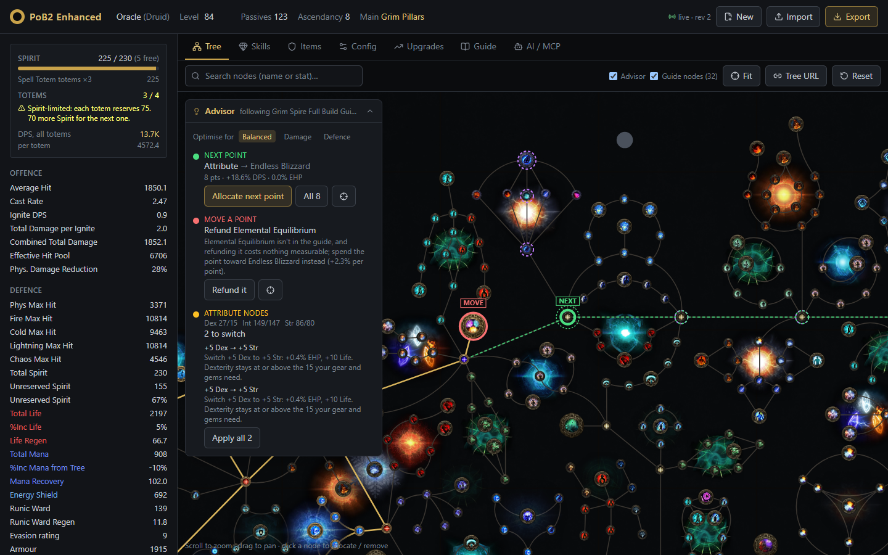
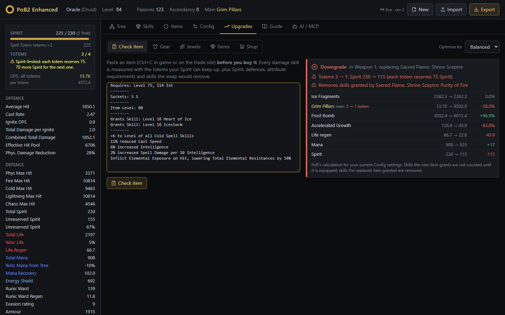
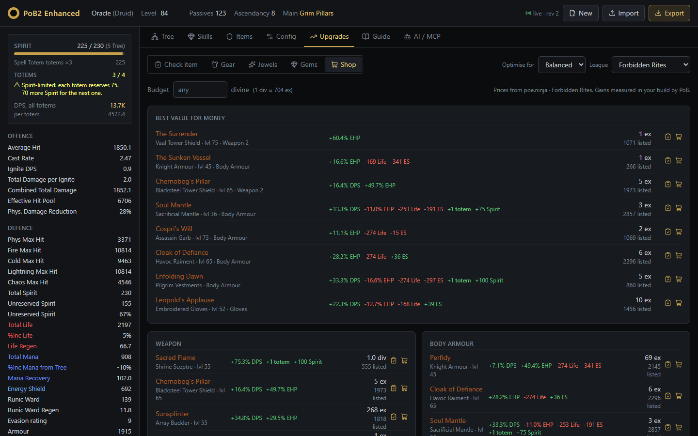

# PoB-Enhanced

**Path of Building 2 for Path of Exile 2, as a self-hosted web app.** It runs the unmodified Path of Building
calculation engine in a Docker container and adds a browser UI, build advisors, a REST API and an MCP server for
AI agents.



Everything below is measured by PoB's own calculator in **your** build, for **your** Config tab settings.

## Features

**Passive tree**
- The game's own PoE2 tree artwork: node icons, frames, socketed jewels, class and ascendancy art, curved orbits.
- Tree links in the official PoE2 planner format (`pathofexile2.com/game/passive-skill-tree/...`), including
  weapon-set and attribute choices.
- **Advisor**: where your next passive point should go (with the path), which point to refund and move, and which
  +5 attribute nodes to switch, with reasons that respect your gear and gem attribute requirements.

**Upgrades**
- **Check before you buy**: paste any item for an upgrade / sidegrade / downgrade verdict across every damage skill,
  with warnings for lost totems, Spirit shortfalls, attribute requirements and skills the swap removes.
- **Gear and jewels**: what each item and each mod is worth (dead mods flagged), what to look for on a replacement,
  how much room for improvement each slot has, and a weighted pathofexile.com trade search per slot.
- **Gems**: what each support is worth, the best replacement for the weakest support in each skill, gem level and
  quality upgrades, and problems like disabled or harmful supports. One click applies a suggestion.
- **Shop**: every unique that fits a slot, measured in your build, with poe.ninja prices, a budget filter and
  "best value for money".

**Spirit and totems.** PoB reports totem damage per totem and doesn't model Ancestral Bond's Spirit cost per totem.
PoB-Enhanced tracks your Spirit budget and the totems you can actually keep up, and every advisor uses **DPS across
all totems**. A weapon that costs you totems shows up as a downgrade.



**Build guides.** Upload a guide's PoE2 BuildPlanner `.build` file (Maxroll and the in-game planner export these)
to see missing and extra passives, skill and support gaps, gear notes, and the guide's notables ranked by gain per
point. The guide's untaken nodes are outlined on the tree.

**Your character, kept in sync.** Import a share code, a pobb.in / pastebin / poe.ninja link, or a **poe.ninja
character page** (ladder or profile). The **Update** button re-imports it later and keeps your Config settings.

**AI agents (MCP).** About 50 tools let Claude or any MCP client load, inspect, what-if and edit builds, using the
same advisors as the UI. The web UI and an agent share one live build.

| Upgrades: gear | Shop | Guide |
|---|---|---|
|  |  |  |

## Run it

You need [Docker](https://docs.docker.com/get-docker/). Then open **http://localhost:8080**.

### Option 1: prebuilt image

```bash
docker run -d --name pob-enhanced --restart unless-stopped -p 8080:8080 ghcr.io/skitty4fingers/pob-enhanced:latest
```

Or with Compose (also handles updates):

```bash
curl -O https://raw.githubusercontent.com/Skitty4fingers/PoB-Enhanced/main/compose.image.yml
docker compose -f compose.image.yml up -d
docker compose -f compose.image.yml pull && docker compose -f compose.image.yml up -d   # update
```

### Option 2: build from source

```bash
git clone https://github.com/Skitty4fingers/PoB-Enhanced.git
cd PoB-Enhanced
docker compose -f compose.enhanced.yml up -d --build
```

The first build takes a few minutes (it compiles LuaJIT and the web UI). To update: `git pull`, then run the same
command again.

### Option 3: NAS / home server (TrueNAS SCALE, Unraid, Portainer, ...)

Create a custom app / container:

| Setting | Value |
|---|---|
| Image | `ghcr.io/skitty4fingers/pob-enhanced:latest` |
| Port | container `8080` → any host port |
| Environment | `POB2_ALLOWED_HOSTS` = the hostname/IP you browse to, e.g. `nas,192.168.1.20` (needed for MCP) |
| Storage | none (the build lives in memory; re-import or press Update after a restart) |

### Option 4: without Docker (Linux / macOS / WSL)

```bash
scripts/setup-engine.sh                 # builds LuaJIT + lua-utf8, installs Python deps, builds the web UI
export PATH="$HOME/.local/bin:$PATH"
uv run --directory python pob2-web      # http://127.0.0.1:8080
```

Requires Python 3.10+, [uv](https://docs.astral.sh/uv/) and Node 22+. The PoE2 tree artwork is already in
`tree-art/`. Details: [docs/enhanced.md](docs/enhanced.md).

## Use it

1. **Import** your character: paste a PoB share code, or your poe.ninja character URL
   (`https://poe.ninja/poe2/profile/<account>/<league>/character/<name>`). Press **Update** whenever your character
   changes.
2. **Tree**: follow the advisor's NEXT and MOVE markers, or hover any node for its stats and what-if deltas.
3. **Upgrades**: start with **Check item** before buying anything, then work through Gear, Jewels, Gems and Shop.
4. **Guide**: upload a guide's `.build` file to see how far you are from it.

### Connect an AI agent

```bash
claude mcp add --transport http pob2 http://localhost:8080/mcp
```

For another machine, set `POB2_ALLOWED_HOSTS` to the hostname you use and connect to `http://<host>:8080/mcp`.
The tools are listed in [docs/enhanced.md](docs/enhanced.md#connecting-ai-agents-mcp).

## Configuration

| Variable | Default | Purpose |
|---|---|---|
| `POB2_PORT` | `8080` | Host port (Compose files) |
| `POB2_BIND` | `127.0.0.1` | Host address to listen on (Compose files). `0.0.0.0` makes it reachable from your network |
| `POB2_ALLOWED_HOSTS` | (none) | Extra hostnames accepted by `/mcp`, comma-separated. localhost always works |
| `POB2_IMAGE` | `ghcr.io/skitty4fingers/pob-enhanced:latest` | Image for `compose.image.yml` |

Put them in a `.env` file next to the Compose file (see `.env.example`).

**Security:** there is no login. Anyone who can reach the port can view and change the loaded build. Keep it on
`127.0.0.1`, a trusted home network, or your tailnet (`compose.tailscale.yml` serves it over Tailscale with HTTPS
and no open ports).

## Development

| Path | What |
|---|---|
| `src/`, `runtime/`, `spec/` | Upstream Path of Building 2, unmodified (kept rebasable on upstream) |
| `engine/` | Headless LuaJIT worker: JSON-RPC handlers including the advisors, budget and tree links |
| `python/` | `pob2` package: engine bridge, REST API (FastAPI), MCP server, CLI, poe.ninja/trade helpers |
| `web/` | React 19 + Vite + Tailwind UI |
| `tree-art/` | PoE2 tree artwork as WebP. Regenerate with `scripts/build_tree_art.py` after a tree data update |

```bash
cd python && uv run pytest && uv run ruff check src tests     # tests (engine tests need LuaJIT, or run in Docker)
cd web && npm ci && npm run build                             # web UI into python/src/pob2/web/static
```

More in [docs/enhanced.md](docs/enhanced.md) (architecture, REST API, MCP tools, worker protocol).

## Credits and licence

PoB-Enhanced is built on [Path of Building Community (PoE2)](https://github.com/PathOfBuildingCommunity/PathOfBuilding-PoE2),
whose calculation engine does all the maths. Prices and character data come from [poe.ninja](https://poe.ninja);
trade searches open on [pathofexile.com](https://www.pathofexile.com/trade2). Game data and artwork © Grinding Gear
Games. This project is not affiliated with or endorsed by Grinding Gear Games, Path of Building Community or
poe.ninja.

Licensed under the [MIT licence](LICENSE.md), like Path of Building.
