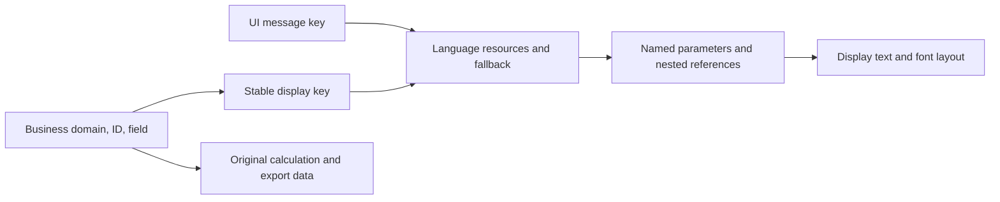

# Localisation guide

[中文](LOCALISATION.zh-CN.md) · [Project entry](../LOCALISATION.md)

This guide describes the implementation in this branch: language selection,
stable display resources, Chinese input adapters, Unicode rendering, and the
tools needed to maintain them. It is organised by responsibility rather than
by the sequence in which changes were made.

[Languages](#1-scope-and-language-status) ·
[Rationale](#2-design-rationale-identify-meaning-with-a-key) ·
[Architecture](#3-architecture-and-display-apis) ·
[Setup](#4-build-and-run-from-source) ·
[Maintenance](#5-maintain-messages-mappings-and-languages) ·
[Fonts](#6-fonts-atlases-and-release-assets) ·
[Provenance](#7-translation-provenance-and-review-inputs) ·
[Verification](#8-verification-and-known-limits) ·
[PR review](#9-upstream-review-and-pr-description)

## 1. Scope and language status

New installations default to **English**. Choose a language in Options and save;
the selection is persisted in `Settings.xml`. Existing builds retain their
original identities and saved user text.

| Language | ID | Display resources | Font |
| --- | --- | --- | --- |
| English | `en` | Canonical definitions and final fallback | Existing Latin rendering |
| 简体中文 | `zh-CN` | Chinese messages and game data; gaps fall back to English | Noto Sans SC |
| 繁體中文 | `zh-TW` | Chinese messages and game data; gaps fall back to English | Noto Sans SC |
| 日本語 | `ja-JP` | Machine translated UI and game text; not manually verified | Noto Sans JP |
| 한국어 | `ko-KR` | Machine translated UI and game text; not manually verified | Noto Sans KR |

These are four language families with two Chinese variants. Japanese and Korean
body text was translated by Codex and has not been manually verified; see the
[translation notes](localisation/ja-ko-translations.md). The selector renders each native language name with its
own font, including when the current interface is English.

The implementation covers interface labels, configuration and calculation
details, skills, items, passives, tooltips, search, and selected import paths.
It retains the existing PoB2 application and SimpleGraphic runtime. It does not
require a separate translation launcher or DLL injection.

## 2. Design rationale: identify meaning with a key

**A stable semantic key identifies a message. English is a resource value.**
For example, `attribute.strength` identifies the attribute; `Strength`, `力量`,
and future translations are values associated with that identity. Editing the
English wording does not require changing the key or invalidating every
translation. Identical English words in different contexts may use different
keys when their meanings or grammar differ.

The earlier approach looked up the final English string during drawing,
measurement, or tooltip insertion. That made punctuation, colour codes,
concatenation, and cached translations part of lookup identity. It could also
confuse user text with application messages and hide missing bindings.

The current approach resolves meaning at the source:

1. A UI call supplies a message key; a game object supplies its business domain,
   ID, and field, which are mapped to a display key.
2. The resource layer resolves the active language and fallback, then formats a
   complete sentence with named parameters.
3. Controls and drawing receive the resulting display text. Drawing and text
   measurement do not guess translations from arbitrary English strings.



Display references are attached separately from original names and modifier
lines. Original IDs, parser input, numbers, sorting identities, and exported
build data remain available to the existing application. User names and notes
are displayed verbatim. Search explicitly checks both the source field and its
display value. Language switching refreshes display state without using a
translated label as a calculation or persistence key.

Input conversion has a separate responsibility: recognise supported translated
item or character input before passing canonical data to the existing parser.
Legacy dictionaries remain input adapters; they no longer provide global
display translation. Ambiguous names are preserved rather than guessed.

## 3. Architecture and display APIs

| Component | Responsibility |
| --- | --- |
| [Localisation.lua](../src/Modules/Localisation.lua) | Current language, display APIs, search and input boundaries |
| [Messages.lua](../src/Modules/Localisation/Messages.lua) | Key lookup, fallback, templates, nested references, resource validation |
| [Languages.lua](../src/Modules/Localisation/Languages.lua) and [Manifest.lua](../src/Locales/Manifest.lua) | Language registration, file lists, fallback and font configuration |
| [DataKeys.lua](../src/Locales/DataKeys.lua), [DataBindings.json](../src/Locales/DataBindings.json), [Terms.lua](../src/Locales/Terms.lua) | Business identity to display key mappings |
| [LineTemplates.lua](../src/Modules/Localisation/LineTemplates.lua) and [ModifierInputs.lua](../src/Modules/Localisation/ModifierInputs.lua) | Bind known source line shapes and modifier identities before display |
| [NameInputs.lua](../src/Modules/Localisation/NameInputs.lua), [Dictionary.lua](../src/Modules/Localisation/Dictionary.lua), [Import.lua](../src/Modules/Localisation/Import.lua) | Domain specific input aliases, legacy input compatibility and character/item conversion |
| [CalcDisplay.lua](../src/Modules/CalcDisplay.lua) | Carry display references through calculation and DPS snapshots |
| [Font.lua](../src/Modules/Localisation/Font.lua) | Unicode layout, measurement, drawing and byte cursor positioning |

| API | Intended use |
| --- | --- |
| `Text(key, parameters)` | Resolve a message now, for immediate display |
| `Label(key, parameters, prefix, suffix)` | Lazy control label; parameters may be a function of the control |
| `Ref(key, parameters)` / `TermRef(domain, id, english)` | Nested display reference resolved in the surrounding message's language |
| `BindFields(domain, id, object)` / `Field(object, field)` | Attach/read a display key without replacing the original field |
| `BindLines(...)` / `Line(...)` / `ModLine(...)` | Display a previously identified line with its current numerical values |
| `Term(domain, id, english)` | Resolve a known domain term; retain the supplied original for unknown identities |
| `ItemName(...)` / `SkillName(...)` | Compose names using known item/skill identities |
| `MatchField(...)` / `MatchModLine(...)` | Search source and displayed text explicitly |
| `RegisterInputNames(...)` / `InputName(...)` | Resolve unique translated names within a business domain |

For example, these keys already exist in the English catalogue:

```lua
local title = localisation:Text('attribute.strength')
local status = localisation:Label('auth.status.waiting', function(control)
    return { value = control.progress }
end)
local sentence = localisation:Text('calc.ailment.effect_column', {
    ailment = localisation:Ref('term.ailment.chill'),
})
```

Use `Ref` when a parameter itself is a message, so a cached parameter does not
retain an earlier language. The last expression resolves both the ailment name
and the surrounding sentence in the current language.
For game data, bind the real domain and ID at load/parse time, then call
`Field(object, 'name')` at display time.

Control properties may contain lazy functions or a companion message key.
Read display labels through `control:GetProperty('label')` or
`control:GetProperty('prompt')`, including in tests; reading the raw property
does not necessarily return the displayed string. Export placeholders and user
buffers retain their original values.

`{value:.1f}` and `{count:d}` specify named parameter formats. Translations may
reorder parameters, but must preserve their names and formats. `{{` and `}}`
represent literal braces. Keep colour codes and the complete sentence in the
resource. Do not assemble a translatable sentence from English fragments.

The multilingual UI work also includes passive tree interaction and drawing
fixes. Input events retain their cursor positions, drag release applies the
remaining movement before clearing state, zoom uses the event position, and
fully offscreen images skip drawing. Dictionary template indexing reduces
candidate matching work while preserving matching order and ambiguity rules.
The [investigation notes](passive-tree-performance.md) retain historical
measurements; current regression results are in section 8.

## 4. Build and run from source

Use the repository root as the working directory. Follow the normal
[development installation instructions](../CONTRIBUTING.md) for PoB2 itself.
The additional tools require Windows, Visual Studio 2022 C++ tools, Node.js/npm,
and Python 3.10 or later for the Python audits.

```cmd
npm ci --prefix tools
build.cmd
test-localisation.cmd
start.cmd
```

`build.cmd` compiles `FontAtlas.exe` and `LuaRunner.exe`, copies the font
generator into `runtime`, and generates the default Chinese atlas. It recognises
the usual VS2022 Community location or an already configured x64 developer
command prompt. It does not rebuild the existing SimpleGraphic application.

`start.cmd` invokes the build when the default `Glyphs.lua` is missing and then
starts the runtime. Lua changes are read by the application; restart after
editing resource CSV files. Do not commit generated executables, atlases,
settings, or the contents of `src/Tests/Run`.

## 5. Maintain messages, mappings, and languages

Display catalogues use a strict two column format:

```csv
key,text
attribute.strength,Strength
auth.status.waiting,Logging in... ({value})
```

Define the English entry in [en/Messages.csv](../src/Locales/en/Messages.csv)
before adding the same key to the target language. Game field resources live
in each language's `Game.csv`. Keys use lowercase semantic paths; duplicate or
empty entries, unknown translated keys, and mismatched parameter signatures
are rejected. A missing translation falls back to English; an undefined message
key is an error rather than an instruction to reverse lookup the English text.

For a new UI message, select `Text`, a lazy `Label`, or an explicit display key
property as appropriate. Keep editable buffers, user names, and persisted
business identities separate. Add a test for a representative dynamic state and
language switch when the message has changing data or cached display state.

For a new game field, use its real domain/ID/field mapping and preserve the
existing stable key. Source line templates are checked before binding: if the
upstream line shape changes, review and update the binding instead of forcing
the old translation onto unknown content. Follow the upstream exporter rules
for generated game data; include the exporter change with regenerated output.

The migration tools `migrate-localisation-keys.cjs`,
`apply-localisation-keys.py`, `apply-message-rekey.py`, and
`migrate-localisation-data.py` are authoring tools. Their apply steps modify
source or catalogues and require reviewed inputs. They are not ordinary test
commands or a complete one command rebuild from a clean clone. Their temporary
candidates and reports belong in `src/Tests/Run`; active mappings and catalogues
remain tracked under `src/Locales`.

To add a language, register a unique ID, native name, fallback, message location
and `messageFiles` in `Manifest.lua`. Add a font configuration for its script.
`Files.lua` lists legacy **input dictionary** CSV files; it does not replace
`messageFiles`. A display only language does not need an input dictionary.
The settings list is derived from the manifest. Validate fallback, parameter
signatures, translated search, layout and switching before claiming support.

## 6. Fonts, atlases, and release assets

The existing drawing interface uses image glyphs. A font file therefore needs a
rendering atlas for this implementation. Shipping the font permits local atlas
generation; it does not require prebuilding every language's atlas.

The current implementation loads a packaged `Glyphs.lua` and TGA pages when
available, otherwise reuses or generates a language cache under the user's
`Path of Building (PoE2)/Fonts` directory. It generates the configured font's
atlas on first use of a language, **not individual glyphs on demand**. Chinese
is generated by `build.cmd`; Japanese and Korean can be generated lazily.
The generator privately loads the project font for that operation and does not
install a system font. `NOTO_SANS_SC_FONT` can override the default SC file.

| Asset | Current use | Licence text |
| --- | --- | --- |
| [NotoSansSC-VF.ttf](../assets/fonts/NotoSansSC-VF.ttf) | Simplified and Traditional Chinese | [SC OFL](licenses/NotoSansSC-OFL.txt) |
| [NotoSansJP-VF.ttf](../assets/fonts/NotoSansJP-VF.ttf) | Japanese | [JP OFL](licenses/NotoSansJP-OFL.txt) |
| [NotoSansKR-VF.ttf](../assets/fonts/NotoSansKR-VF.ttf) | Korean | [KR OFL](licenses/NotoSansKR-OFL.txt) |
| [NotoSansCJKkr-Regular.otf](../assets/fonts/NotoSansCJKkr-Regular.otf) | Retained alternative asset; not selected or packaged by the current font manifest | [CJK KR OFL](licenses/NotoSansCJKkr-OFL.txt) |

The VF files originate from Google Fonts' `ofl/notosanssc`, `ofl/notosansjp`,
and `ofl/notosanskr` directories. The alternative Korean Regular is an unchanged
file from the supplied Noto CJK archive. Preserve the supplied copyright and
OFL notices with redistributed fonts. The retained Alimama notice describes an
earlier candidate; no Alimama font is selected by the manifest. Microsoft YaHei
is not the configured project font.

The generator uses Windows GDI, a fixed 32 px glyph size and BMP codepoints,
excluding surrogates. This does not guarantee coverage of all Unicode, every
regional glyph form, or separate bold/italic styles. Lazy generation saves
prepackaged atlas space but still incurs first use work and disk cache space.

[manifest.cfg](../manifest.cfg) includes the three VF fonts and Noto OFL files.
Runtime distributions need `FontAtlas.exe` or compatible prebuilt atlases in
addition to these font files. Official packaging uses the existing upstream
release process. Linux/macOS font generation is not implemented by this
Windows tool. Independent releases of this fork are outside the feature PR.

## 7. Translation provenance and review inputs

Keep human review inputs versioned and generated audit snapshots out of docs:

| File | Purpose |
| --- | --- |
| [display-review.json](localisation/display-review.json) | Reviewed exceptions for the mandatory display scanner; source identity, mode, count and review rationale |
| [skill-sources.csv](localisation/sources/skill-sources.csv) | Skill description sources, English hashes, extraction method and Chinese review status |
| [skill-terminology.csv](localisation/sources/skill-terminology.csv) | Previous/established terminology and supporting evidence |
| [equipment-terms.csv](localisation/sources/equipment-terms.csv) | Source terms, translations, and provenance |
| [Japanese/Korean notes](localisation/ja-ko-translations.md) | Codex translation source, terminology and lack of manual verification |

The skill source table covers 1,095 descriptions: 957 English matched source
entries and 138 project supplements. It is a provenance record for those rows,
not a complete source register for every catalogue entry or a translation
accuracy score. Source references include PoE2DB; project supplements must not
be presented as official game translations.

Equipment terminology combines existing project dictionaries, uniquely matched
public trade item data, and project supplements. Regional trade API arrays
must not be paired by index. Legacy dictionaries originated from PoeCharm and
can contain older PoE terms; verify the current PoE2 identity before reuse.
Source availability and permission to redistribute translation text are separate
questions. Font OFL notices do not establish rights for external translation
tables; their upstream provenance and redistribution basis still need review.

The scanner runs six AST modes: display calls, fields, lists, statuses, display
state, and breakdowns. A newly unbound string, unreviewed shared expression,
unknown fixed key, or reintroduced global display lookup causes failure.
Review a new candidate individually; do not regenerate the exception file to
make the check pass. Static scanning cannot prove all indirect flows or dynamic
states are covered.

## 8. Verification and known limits

The Japanese and Korean machine translations have passed the catalogue key and
named parameter checks. They have not been manually proofread or visually
verified. Integration assertions cover the existing application scenarios and
five language page smoke checks, not the linguistic accuracy of every entry.

Run the main regression from the repository root:

```cmd
test-localisation.cmd
python tools/check-atlas.py
python tools/audit-locale-resources.py
python tools/audit-localisation-keys.py
python tools/audit-localisation.py
```

The main command runs the scanner, resource/input contracts, and real PoB2
integration tests through the official LuaJIT DLL. Fixtures include three
offline poe.ninja exports; see the [fixture provenance](../src/Tests/Fixtures/poe-ninja/README.md).
It checks language switches, controls, search, tooltips, calculation displays,
original identities and XML export. It is not a live network authentication
test or a substitute for visual inspection.

For additional runtime audits, run the following after the main command or
`audit-localisation.py` has created `src/Tests/Run`:

```cmd
cd src
..\tools\LuaRunner.exe ..\tools\audit-visible-localisation.lua
..\tools\LuaRunner.exe ..\tools\audit-item-display.lua
..\tools\LuaRunner.exe ..\tools\audit-localisation-boundaries.lua
```

All generated inventories, missing text candidates, and reports go to ignored
`src/Tests/Run`. `audit-localisation-matching.lua` is a legacy input dictionary
probe, not a test of the current display pipeline. A Latin text candidate may
be a proper name, unit, user text or fallback; inspect context before changing it.

<!-- verification-current -->
Verified locally on Windows on **2026-10-31**, with product code at
`772aa51f2` (Japanese/Korean resources and registration included).
These checks used the existing local runner and Chinese atlas; they were not a
clean build. The atlas and Chinese dictionary findings below retain their
earlier verification scope.

| Check | Result |
| --- | --- |
| `test-localisation.cmd` | Exit 0; 311 reviewed display occurrences, 218 contract assertions, 423,612 integration assertions |
| Upstream system specs (official container, local WSL) | 52 files, 903 successes, no failures/errors/pending after adapting three specs to display properties and metadata; the corrected item spec was rerun separately |
| ModCache regeneration (same container) | Exit 0; regenerated file matches the tracked LF blob, with `./?.lua` added to the source search path as explained below |
| Passive tree interaction | 28 assertions pass |
| Display review preservation | All 290 review records retained unchanged; the scanner counts occurrences, not JSON records |
| `check-atlas.py` | Exit 0; 10 Chinese atlas pages pass RLE row boundary and pixel integrity checks |
| `audit-locale-resources.py` | Display catalogue audit function reports no key/parameter errors for all five language options; the earlier full audit also covered the Chinese input dictionaries |
| `audit-localisation-keys.py` | Exit 0; Chinese fallback counts below |
| `audit-localisation.py` | Exit 0; 19,605 display fields checked per language (`en`, `zh-CN`, `zh-TW`), with no resolution errors |

| Resource count | English | Simplified Chinese | Traditional Chinese | Japanese | Korean |
| --- | ---: | ---: | ---: | ---: | ---: |
| Defined display keys | 123,836 | 123,176 | 123,181 | 123,836 | 123,836 |
| Missing translations falling back to English | — | 660 | 655 | 0 | 0 |
| Of these: world area resources | — | 633 | 630 | 0 | 0 |
| Of these: stat description resources | — | 24 | 22 | 0 | 0 |
| Of these: equipment modifier resources | — | 3 | 3 | 0 | 0 |

The old input dictionary audit separately reports 395/612 placeholder mismatch
candidates and 2,450/2,485 reverse collision groups (Simplified/Traditional).
It also reports one historical Traditional Chinese codepoint absent from the
current SC atlas. These input dictionary findings do not run through display
lookup and do not establish that every import path is compatible. Review
ambiguous input with its domain context. Catalogue coverage and assertion
counts do not establish translation accuracy or complete visual coverage.
<!-- /verification-current -->

Earlier native window checks covered English/Simplified/Traditional switching,
DPS labels, notes controls, and all five native language names. Those are prior
manual observations, not a fresh window or IME test performed for this
documentation change. Existing missing tree node warnings remain. A reported
tree search focus issue has no established root cause or verified fix here.

The existing [CI workflow](../.github/workflows/test.yml) runs system specs and
ModCache checks. On 2026-10-31, all 52 system files were run separately in its
`ghcr.io/pathofbuildingcommunity/pathofbuilding-tests` image (digest
`sha256:171dc3da232b8c874882e4ae3b3aa4a6e130a6c9450a31904b312435a6bf5daf`),
using a source copy without generated font atlases, at `5cdfb5daa`. Three specs
were adapted to lazy display properties or added display metadata, preserving
their original English values, line counts and export/persistence expectations.
The corrected item spec was rerun separately and passed all 77 cases.

The exact upstream ModCache command overrides `LUA_PATH` without `./?.lua` and
fails to load `Data.VerisiumCrafts` in this image; the same failure reproduces
on unmodified upstream `dev` at `bb52d6b36`. Adding `./?.lua` to the local
verification command allows startup and actual ModCache regeneration to
complete; its output matches the tracked file byte for byte. This feature PR
retains the upstream workflow. These local container results do not establish
a passing hosted Actions run or graphical Linux/macOS font support.

## 9. Upstream review and PR description

Submit against `dev` as required by [CONTRIBUTING.md](../CONTRIBUTING.md).
Review the final diff in this order: message contract and identity boundaries;
UI/game call sites and display cache handling; English, Chinese, Japanese and Korean resources;
font build/release files; regression fixtures and tools. Large generated tables
need their generation inputs and process reviewed alongside their output.

Review the redistribution basis for external translations and attach available
verification evidence and representative window screenshots. The feature PR
does not introduce a separate release pipeline; independent fork releases are
maintained on a separate release branch.

Suggested PR title: **Add key based localisation with Chinese, Japanese and Korean resources**.
Adapt the following to the final submitted scope and the repository PR template:

> **Description of the problem being solved:**
> Add language selection and explicit semantic message keys to PoB2. UI messages
> and game display fields resolve through language resources while original
> calculation, parser and export identities are preserved. Include Simplified
> and Traditional Chinese resources, domain aware input/search integration, and
> Noto CJK font assets and the passive tree interaction/drawing fixes. Also include Codex translated Japanese and Korean body
> text, which has not been manually verified.
>
> **Steps taken to verify a working solution:**
> Local Windows regression passes: 311 reviewed display occurrences, 218
> contract assertions, and 423,612 integration assertions. Catalogue keys and
> named parameters validate for all five language options. Earlier atlas and
> field audit results retain the scope described in section 8. Independent fork
> releases are outside this PR. The upstream container system specs pass all 903
> cases across 52 files; ModCache regeneration is unchanged with the local source
> path correction described above.

Fill issue references, a showcase build and before/after screenshots only when
real evidence is available. Do not treat this suggested text as a published PR
or as evidence that upstream maintainers have accepted the design.
