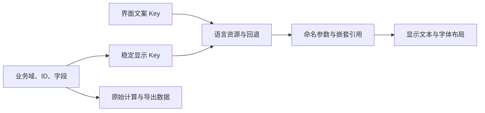

# 本地化指南

[English](LOCALISATION.en.md) · [项目入口](../LOCALISATION.md)

本文说明当前分支的语言切换、稳定显示资源、中文输入适配、Unicode 渲染，以及后续维护和验证方法。章节按职责组织，不再按每次执行的时间顺序记录。

[语言现状](#1-范围与语言现状) · [修改思路](#2-修改思路用-key-标识含义) ·
[架构接口](#3-架构与显示接口) · [构建运行](#4-从源码构建与运行) ·
[资源维护](#5-文案映射和新增语言的维护) · [字体发布](#6-字体图集与发布资源) ·
[翻译来源](#7-翻译来源与审查输入) · [验证边界](#8-验证方法与已知边界) ·
[PR 审阅](#9-上游审阅与-pr-说明)

## 1. 范围与语言现状

新安装默认使用 **English**。在“选项”中选择语言并保存，选择会写入 `Settings.xml`。已有构筑继续使用原来的业务身份和用户保存内容。

| 语言 | ID | 正文资源 | 字体 |
| --- | --- | --- | --- |
| English | `en` | 完整定义及最终回退 | 既有拉丁文字渲染 |
| 简体中文 | `zh-CN` | 界面及游戏数据译文，缺项回退英文 | Noto Sans SC |
| 繁體中文 | `zh-TW` | 界面及游戏数据译文，缺项回退英文 | Noto Sans SC |
| 日本語 | `ja-JP` | 界面及游戏正文机器译文，未人工验证 | Noto Sans JP |
| 한국어 | `ko-KR` | 界面及游戏正文机器译文，未人工验证 | Noto Sans KR |

这是四种语言、中文分简繁两个选项。日语和韩语正文由 Codex 翻译，未人工验证；制作方式见[日／韩译文说明](localisation/ja-ko-translations.md)。语言选择器用每种语言自己的字体显示本名，因此英文界面中也能正确显示日文、韩文选项。

当前接入范围包括界面标签、配置与计算详情、技能、装备、天赋、提示框、搜索和部分导入路径。程序继续使用 PoB2 原有应用和 SimpleGraphic 运行时，无需独立汉化启动器或 DLL 注入。

## 2. 修改思路：用 Key 标识含义

**文本以稳定的语义 Key 为标识，英文本身只是资源值。** 例如 `attribute.strength` 标识“力量属性”，`Strength`、`力量`及未来译文都是同一身份对应的资源值。修改英文措辞不必更换 Key，也不会因此让其他语言全部失效。同一英文单词若处于不同语义或语法场景，可以分别使用不同 Key。

早期方案在绘制、测宽或提示框插入的末端，按最终英文字符串反查词典。这样会把标点、颜色码、拼接结果和缓存译文都变成识别条件；既可能误处理用户文字，也容易用兜底翻译掩盖调用点没有绑定资源的问题。

现在改为在来源处明确身份：

1. 界面调用直接提供文案 Key；游戏对象以业务域、ID、字段映射到显示 Key。
2. 资源层按当前语言及回退链取值，再通过命名参数生成完整句子。
3. 控件与绘制接收已经确定的显示文本；绘制、测宽不再根据任意英文推测该翻译什么。



显示引用与原始名称、词缀行分开保存。计算、解析、排序、索引和导出继续使用原始 ID、名称及数值；用户名称与备注原样显示。搜索明确同时检查原字段和当前译文。切换语言时刷新显示状态，不把译后的标签当作计算或保存的主键。

输入转换单独负责在物品、角色导入边界识别受支持的译文，再交给原有解析器。旧词典保留输入适配职责，不再负责全局显示翻译。无法唯一确定的同名对象保留原文，不猜测替换。

## 3. 架构与显示接口

| 组件 | 职责 |
| --- | --- |
| [Localisation.lua](../src/Modules/Localisation.lua) | 当前语言、显示接口、搜索与输入边界 |
| [Messages.lua](../src/Modules/Localisation/Messages.lua) | Key 查找、回退、模板、嵌套引用和资源校验 |
| [Languages.lua](../src/Modules/Localisation/Languages.lua) 与 [Manifest.lua](../src/Locales/Manifest.lua) | 语言注册、资源清单、回退与字体配置 |
| [DataKeys.lua](../src/Locales/DataKeys.lua)、[DataBindings.json](../src/Locales/DataBindings.json)、[Terms.lua](../src/Locales/Terms.lua) | 业务身份到显示 Key 的映射 |
| [LineTemplates.lua](../src/Modules/Localisation/LineTemplates.lua) 与 [ModifierInputs.lua](../src/Modules/Localisation/ModifierInputs.lua) | 在显示前绑定已知的原文行结构及词缀身份 |
| [NameInputs.lua](../src/Modules/Localisation/NameInputs.lua)、[Dictionary.lua](../src/Modules/Localisation/Dictionary.lua)、[Import.lua](../src/Modules/Localisation/Import.lua) | 分业务域的输入别名、旧输入兼容与角色／物品转换 |
| [CalcDisplay.lua](../src/Modules/CalcDisplay.lua) | 在计算结果和 DPS 快照中保留显示引用 |
| [Font.lua](../src/Modules/Localisation/Font.lua) | Unicode 布局、测宽、绘制与字节光标定位 |

| 接口 | 使用场景 |
| --- | --- |
| `Text(key, parameters)` | 立即解析当前要显示的文案 |
| `Label(key, parameters, prefix, suffix)` | 延迟解析控件标签；参数可以由控件回调提供 |
| `Ref(key, parameters)` / `TermRef(domain, id, english)` | 把另一条文案作为参数，在外层句子使用的语言中解析 |
| `BindFields(domain, id, object)` / `Field(object, field)` | 附加／读取显示引用，保留原字段 |
| `BindLines(...)` / `Line(...)` / `ModLine(...)` | 显示已确定身份的属性行，并保留当前数值 |
| `Term(domain, id, english)` | 显示已注册业务术语；未知身份保留给定原文 |
| `ItemName(...)` / `SkillName(...)` | 使用已知装备／技能身份组合显示名称 |
| `MatchField(...)` / `MatchModLine(...)` | 显式搜索原文及显示译文 |
| `RegisterInputNames(...)` / `InputName(...)` | 在指定业务域内解析唯一译名 |

下面使用的 Key 已存在于英文资源：

```lua
local title = localisation:Text('attribute.strength')
local status = localisation:Label('auth.status.waiting', function(control)
    return { value = control.progress }
end)
local sentence = localisation:Text('calc.ailment.effect_column', {
    ailment = localisation:Ref('term.ailment.chill'),
})
```

参数本身也是文案时使用 `Ref`，避免参数缓存成上一种语言的字符串。最后一例的异常状态名称和外层句子会在同一种当前语言中解析。游戏字段则应在加载／解析时绑定真实业务域和 ID，显示时调用 `Field(object, 'name')`。

控件属性可能是延迟解析函数，也可能带有独立文案 Key；包括测试在内，都应通过 `control:GetProperty('label')` 或 `control:GetProperty('prompt')` 读取显示文案，直接读原属性不一定得到字符串。导出占位值和用户缓冲区仍保留原始值。

`{value:.1f}`、`{count:d}` 表示命名参数及格式。译文可以调整参数顺序，但必须保留参数名称和格式。`{{`、`}}` 表示字面花括号。颜色码和完整句子一起放进资源，不用英文片段拼装需要翻译的句子。

多语言界面工作也包含天赋树交互与绘制修复：输入事件保留光标坐标，释放时先补齐拖动末段位移再清理状态，缩放围绕事件位置，完全位于屏幕外的图片跳过绘制。词典模板索引减少候选匹配，同时保留原匹配顺序和歧义规则。[排查说明](passive-tree-performance.md)保留历史性能测量，当前回归结论以第 8 节为准。

## 4. 从源码构建与运行

以下命令以仓库根目录为工作目录。PoB2 本身的安装遵循[开发环境说明](../CONTRIBUTING.md)。新增工具需要 Windows、Visual Studio 2022 C++ 工具、Node.js/npm；Python 审计脚本使用 Python 3.10 或更新版本。

```cmd
npm ci --prefix tools
build.cmd
test-localisation.cmd
start.cmd
```

`build.cmd` 编译 `FontAtlas.exe`、`LuaRunner.exe`，将字体生成器复制到 `runtime`，并生成默认中文图集。脚本支持常规 VS2022 Community 安装位置，也可在已配置的 x64 开发者命令提示符中运行；不重新编译既有 SimpleGraphic 应用。

`start.cmd` 在默认 `Glyphs.lua` 缺失时调用构建，然后启动运行时。业务源码是 Lua；修改 CSV 资源后重新启动。生成的可执行文件、图集、个人设置以及 `src/Tests/Run` 内容不进入 Git。

## 5. 文案、映射和新增语言的维护

显示资源严格采用两列 CSV：

```csv
key,text
attribute.strength,Strength
auth.status.waiting,Logging in... ({value})
```

先在 [en/Messages.csv](../src/Locales/en/Messages.csv) 定义英文条目，再向目标语言加入相同 Key。游戏字段资源位于各语言的 `Game.csv`。Key 使用小写语义路径；重复 Key、空值、没有英文定义的译文、参数集合或格式不一致都会被拒绝。缺少某种译文时回退英文；Key 本身未定义则报错，不转而按英文反查。

新增界面文案时，根据显示时机使用 `Text`、延迟 `Label` 或显式显示 Key 属性。编辑缓冲区、用户名称和保存的业务身份独立处理。涉及动态数据或缓存时，为代表性状态和语言切换补充回归场景。

新增游戏字段时，以真实业务域／ID／字段建立映射，保留已有稳定 Key。原文行模板在绑定前校验；上游原文结构变化时，应审查并更新绑定，不能把旧译文强套到未知内容。自动生成的游戏数据遵循上游导出规则，生成器修改与重新生成的结果一起提交。

`migrate-localisation-keys.cjs`、`apply-localisation-keys.py`、`apply-message-rekey.py` 和 `migrate-localisation-data.py` 属于资源制作工具。应用步骤会修改源码或词库，必须使用经过审阅的输入；它们不是普通测试命令，也不能从干净检出一条命令重建全部翻译。临时候选和报告位于 `src/Tests/Run`，生效的映射与词库继续在 `src/Locales` 中跟踪。

新增语言时，在 `Manifest.lua` 注册唯一 ID、本名、回退语言、显示资源位置及 `messageFiles`，并为相应文字配置字体。`Files.lua` 列出旧的**输入词典** CSV，不能替代 `messageFiles`；只有显示需求的语言不必提供输入词典。设置列表从注册表生成。声明支持之前，要验证回退、模板参数、译名搜索、布局及切换。

## 6. 字体、图集与发布资源

当前绘制接口使用图片字形，因此本实现需要把字体转换成渲染图集。随软件提供字体文件后，可以在本地生成图集，无需把所有语言的图集都预先打包。

当前逻辑优先读取已提供的 `Glyphs.lua` 和 TGA 页面；否则复用或生成用户目录 `Path of Building (PoE2)/Fonts` 下的语言缓存。生成粒度是**首次使用某种语言时生成该配置字体的图集，不是逐字符动态生成**。`build.cmd` 预生成中文，日文、韩文可以延迟生成。生成器在运行期间私有加载项目字体，不安装系统字体。环境变量 `NOTO_SANS_SC_FONT` 可以覆盖默认 SC 文件。

| 字体资产 | 当前用途 | 许可证原文 |
| --- | --- | --- |
| [NotoSansSC-VF.ttf](../assets/fonts/NotoSansSC-VF.ttf) | 简体、繁体中文 | [SC OFL](licenses/NotoSansSC-OFL.txt) |
| [NotoSansJP-VF.ttf](../assets/fonts/NotoSansJP-VF.ttf) | 日文 | [JP OFL](licenses/NotoSansJP-OFL.txt) |
| [NotoSansKR-VF.ttf](../assets/fonts/NotoSansKR-VF.ttf) | 韩文 | [KR OFL](licenses/NotoSansKR-OFL.txt) |
| [NotoSansCJKkr-Regular.otf](../assets/fonts/NotoSansCJKkr-Regular.otf) | 保留的备用字体，当前运行配置及字体发布清单未选用 | [CJK KR OFL](licenses/NotoSansCJKkr-OFL.txt) |

三个 VF 字体来自 Google Fonts 仓库的 `ofl/notosanssc`、`ofl/notosansjp`、`ofl/notosanskr` 目录。备用韩文 Regular 从提供的 Noto CJK 压缩包原样提取。分发字体时保留随附版权和 OFL 声明。保留的阿里妈妈声明对应早期候选字体，当前配置未选用阿里妈妈字体；项目配置也不再使用 Microsoft YaHei。

生成器基于 Windows GDI，使用固定 32 px 字号，只生成 BMP 码点并排除代理区。这不等于覆盖所有 Unicode、所有地区字形，也不代表有独立粗体／斜体。延迟生成减少预打包图集，但仍有首次生成时间和磁盘缓存成本。

[manifest.cfg](../manifest.cfg) 已包含三个 VF 字体及 Noto OFL 文件。运行包还需包含 `FontAtlas.exe` 或兼容的预生成图集。官方组包沿用上游既有发布流程；本仓库独立 Release 在单独的发布分支维护，不属于多语言功能 PR。Windows 生成工具不提供 Linux/macOS 的字体生成实现。

## 7. 翻译来源与审查输入

人工审查输入继续版本化，可重建的审计快照移出文档目录：

| 文件 | 用途 |
| --- | --- |
| [display-review.json](localisation/display-review.json) | 强制显示扫描的审阅例外；保存源码身份、模式、次数和审查依据 |
| [skill-sources.csv](localisation/sources/skill-sources.csv) | 技能描述来源、英文哈希、提取方式及中文审查状态 |
| [skill-terminology.csv](localisation/sources/skill-terminology.csv) | 原术语、约定术语和依据 |
| [equipment-terms.csv](localisation/sources/equipment-terms.csv) | 原文、译文及来源 |
| [日／韩译文说明](localisation/ja-ko-translations.md) | Codex 翻译来源、术语及未人工验证状态 |

技能来源表覆盖 1,095 条描述，其中 957 条为英文匹配的来源条目，138 条为项目补充。这是对应条目的溯源资料，不是全部资源的完整来源登记，也不是翻译准确率。来源包括 PoE2DB；项目补译不能标作官方游戏译文。

装备术语由既有项目词库、唯一匹配的公开交易物品数据及项目补充组成。不同地区交易接口的数组不能按索引配对。旧词典来自 PoeCharm，可能包含旧版 PoE 术语，复用前必须确认当前 PoE2 业务身份。来源可访问和译文可再分发是不同问题；字体 OFL 不覆盖外部翻译表，后者的来源及再分发依据仍需审查。

显示扫描包含六种 AST 模式：显示调用、字段、列表、状态、显示状态和计算分解。新增未绑定字符串、未审阅共享表达式、不存在的固定 Key，或恢复全局显示反查都会导致检查失败。新增候选必须逐项审查，不能整体重建例外表来绕过检查。静态扫描无法证明所有间接数据流和动态状态都已覆盖。

## 8. 验证方法与已知边界

日语／韩语机器译文已通过资源 Key 和命名参数检查，未做人工校对或窗口视觉验收。集成断言覆盖既有应用场景及五种语言页面的基础绘制检查，不代表逐条译文的语言准确性。

在仓库根目录运行：

```cmd
test-localisation.cmd
python tools/check-atlas.py
python tools/audit-locale-resources.py
python tools/audit-localisation-keys.py
python tools/audit-localisation.py
```

主命令通过官方 LuaJIT DLL 执行显示扫描、资源／输入契约和真实 PoB2 集成测试，使用三份离线 poe.ninja 导出构筑，[来源说明见 fixture 文档](../src/Tests/Fixtures/poe-ninja/README.md)。检查语言切换、控件、搜索、提示框、计算显示、原始身份及 XML 导出；不执行在线鉴权，也不能替代窗口视觉检查。

主命令或 `audit-localisation.py` 创建 `src/Tests/Run` 后，可进一步运行：

```cmd
cd src
..\tools\LuaRunner.exe ..\tools\audit-visible-localisation.lua
..\tools\LuaRunner.exe ..\tools\audit-item-display.lua
..\tools\LuaRunner.exe ..\tools\audit-localisation-boundaries.lua
```

范围清单、未翻译候选及报告统一写入被忽略的 `src/Tests/Run`。`audit-localisation-matching.lua` 只探测旧输入词典，不代表当前显示链路。含拉丁文字的候选可能是专名、单位、用户内容或英文回退，应结合上下文判断，不能见英文就替换。

<!-- verification-current -->
**2026-10-31** 在 Windows 本地验证，产品代码基于 `772aa51f2`（已包含日／韩词库和语言注册）。使用已有本地测试入口和中文图集，未执行干净构建。下述图集及中文输入词典结果保留先前的验证范围。

| 检查 | 结果 |
| --- | --- |
| `test-localisation.cmd` | 退出 0；311 个已审阅显示入口、218 项契约断言、423,612 项集成断言通过 |
| 上游系统测试（官方容器，WSL 本地） | 52 个文件、903 个用例通过，失败／错误／待定为 0；三处测试适配显示属性及元数据，修正后的物品测试另行复跑 |
| ModCache 重生成（同一容器） | 退出 0；补充 `./?.lua` 搜索路径后实际重生成，与 Git 中 LF 版本逐字节一致，原因见下文 |
| 天赋树交互回归 | 28 项断言通过 |
| 显示审查输入保留 | 290 条审查记录内容不变；扫描器按入口出现次数统计，与 JSON 条目数不同 |
| `check-atlas.py` | 退出 0；10 页中文图集的 RLE 行边界与像素完整性检查通过 |
| `audit-locale-resources.py` | 显示资源审计函数检查五种语言选项，Key／参数错误为 0；此前完整审计另覆盖中文输入词典 |
| `audit-localisation-keys.py` | 退出 0；中文英文回退数量见下表 |
| `audit-localisation.py` | 退出 0；英文、简体、繁体各检查 19,605 个显示字段，解析异常为 0 |

| 资源统计 | 英文 | 简体 | 繁体 | 日语 | 韩语 |
| --- | ---: | ---: | ---: | ---: | ---: |
| 已定义显示 Key | 123,836 | 123,176 | 123,181 | 123,836 | 123,836 |
| 缺译并回退英文 | — | 660 | 655 | 0 | 0 |
| 其中：区域资源 | — | 633 | 630 | 0 | 0 |
| 其中：属性描述资源 | — | 24 | 22 | 0 | 0 |
| 其中：装备修饰词资源 | — | 3 | 3 | 0 | 0 |

旧输入词典另报告简／繁参数差异候选 395／612、反向冲突组 2,450／2,485，以及繁体一处历史码点不在当前 SC 图集中。这些输入词典问题不参与显示查找，也不能据此宣称全部导入路径兼容；同名歧义必须结合输入业务域审查。词库覆盖率和断言数量均不能代替译文准确性及完整视觉验收。
<!-- /verification-current -->

此前的原生窗口检查涉及英文／简体／繁体往返切换、DPS 标签、备注控件及五个语言本名。这些是既往人工观察，不是本次文档整理新执行的窗口或输入法测试。既有天赋 missing-node 警告仍保留；此前报告过树搜索聚焦问题，本次没有据此声称已定位根因或修复。

2026-10-31 基于 `5cdfb5daa`，使用既有 [CI 工作流](../.github/workflows/test.yml) 的 `ghcr.io/pathofbuildingcommunity/pathofbuilding-tests` 官方镜像，在无已生成字体图集的源码副本中逐文件运行全部 52 个系统测试。镜像摘要为 `sha256:171dc3da232b8c874882e4ae3b3aa4a6e130a6c9450a31904b312435a6bf5daf`。三处测试适配延迟显示属性或附加显示元数据，保留原有英文值、词缀数量及导出／持久化预期；修正后的物品测试另行复跑，77 个用例通过。

上游 ModCache 原命令覆盖 `LUA_PATH` 后未包含 `./?.lua`，在该镜像中找不到 `Data.VerisiumCrafts`；未修改的上游 `dev`（`bb52d6b36`）同样复现。本地验证命令补充该搜索路径后正常启动并完成实际重生成，结果与 Git 中的文件逐字节一致。本功能 PR 保留上游工作流；上述 WSL 本地容器结果不代表 GitHub 托管 CI 已通过，也不代表 Linux/macOS 图形字体支持。

## 9. 上游审阅与 PR 说明

根据 [CONTRIBUTING.md](../CONTRIBUTING.md)，PR 目标为 `dev`。建议依次审阅：文案契约与身份边界；界面／游戏调用点及显示缓存；英文、中文、日文和韩文资源；字体构建与发布文件；回归 fixture 与工具。大型生成表应连同输入和生成过程一起审查。

审阅外部翻译资源的再分发依据，并附上已有验证证据及代表性窗口截图。PR 范围为多语言功能及必要测试；本仓库独立 Release 的打包发布在单独分支维护。

建议 PR 标题：**Add key based localisation with Chinese, Japanese and Korean resources**。按最终实际提交范围和仓库 PR 模板调整以下内容；英文版本的同一章节提供可供上游审阅的英文措辞。

> **解决的问题：**
> 为 PoB2 增加语言选择及显式语义 Key。界面文案和游戏显示字段通过语言资源解析，计算、解析和导出仍使用原始身份。提供简繁中文资源、按业务域处理的输入／搜索、Noto CJK 字体及天赋树交互／绘制修复。另接入 Codex 生成的日语和韩语正文译文，未人工验证。
>
> **验证方式：**
> Windows 本地回归通过：311 个已审阅显示入口、218 项契约断言、423,612 项集成断言。五种语言选项的资源 Key 及命名参数检查无错误；此前图集及字段审计结果保留第 8 节所列范围。本仓库独立 Release 不属于此 PR。上游容器中 52 个系统测试文件、903 个用例通过；补充源码搜索路径后 ModCache 重生成无差异。

只有拿到真实证据后再填写关联 issue、演示构筑和前后截图，不虚构链接。这是 PR 说明建议，不表示已经发布 PR 或上游已经接受方案。
